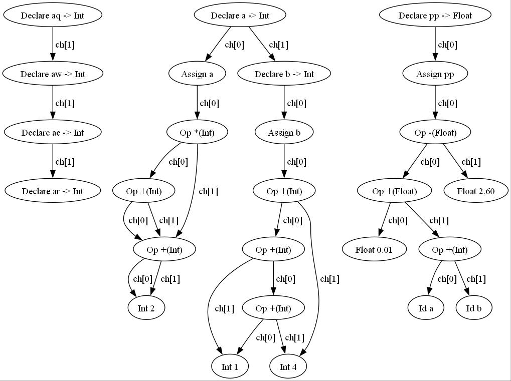
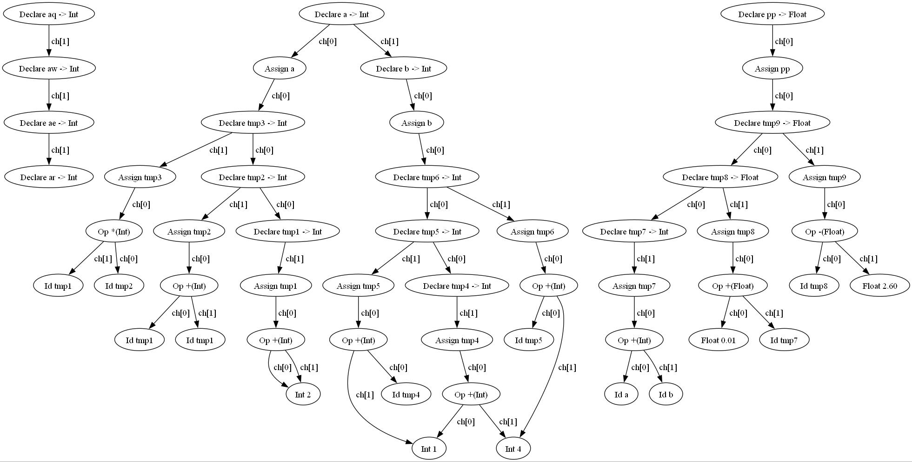
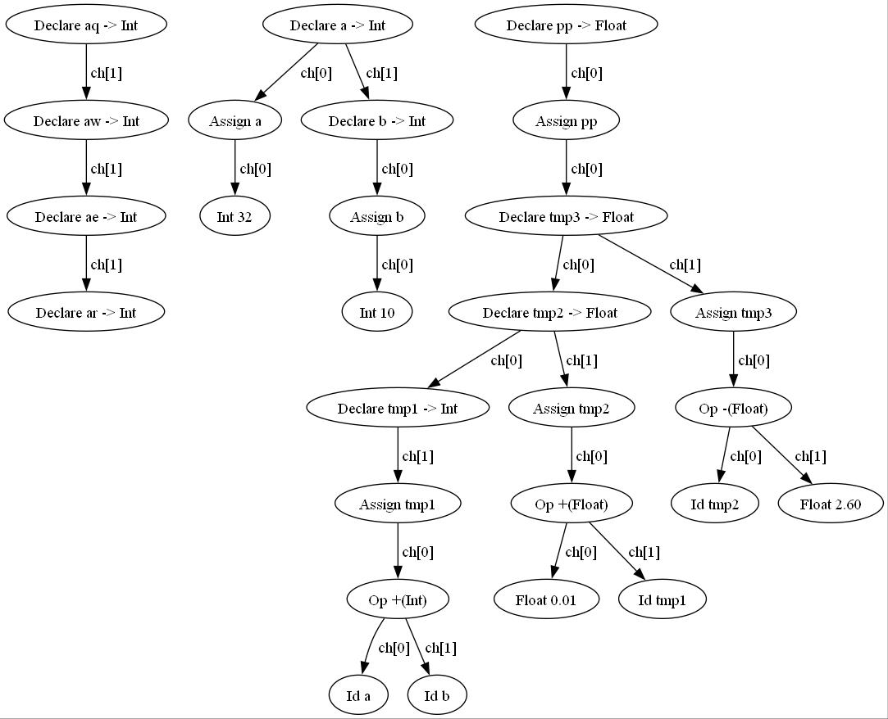

# TINY compiler extensions

[中文](README_zh.md)

This project extends the TINY compiler with language features and expression optimizations, and includes a TM virtual machine for executing generated instructions.

## Highlights

### 1. Floating-point arithmetic

Supports floating-point constants and arithmetic.

### 2. XOR

Supports the integer XOR operator `^`.

### 3. Greater than or equal and less than or equal

Supports `>=` and `<=` in analysis and TM instruction generation.

### 4. Integer conditions

Supports integers directly in `if` conditions.

### 5. Type declarations

Supports `int` and `float` declarations and use after declaration.

### 6. Initialization and duplicate declaration checks

Supports initialization in declarations and checks duplicate declarations.

### 7. Expression DAG optimization

Merges repeated subexpressions within an expression.



### 8. Temporary variable optimization

Stores merged expression results in temporary variables for reuse in generated code.



### 9. Declaration type checks

Checks constant initialization values in declarations.

### 10. Constant folding

Combines constant calculations in expressions.



## Layout

```text
src/compiler/       compiler source files
src/vm/             TM virtual machine source
include/compiler/   compiler headers
examples/           TINY example inputs
docs/images/        syntax tree images and DOT files
docs/reference/     reference code
```

## Examples

| Input | Features | Expected output |
| --- | --- | --- |
| `examples/arithmetic.tny` | Floating-point declaration, initialization, and multiplication | `10.000000` |
| `examples/conditions.tny` | `>=` conditional and integer XOR | `1`, `6` |
| `examples/optimization.tny` | Repeated subexpressions and temporary variables | `49` |

## Build and run

### Windows (PowerShell + MinGW)

Install CMake 3.21 or later, `g++`, and `mingw32-make`, and add them to `PATH`. From the repository root:

```powershell
cmake --preset mingw
cmake --build --preset mingw
Copy-Item examples/optimization.tny build/optimization.tny
cd build
.\tiny.exe optimization.tny
Get-Content .\optimization.tm
.\tm.exe optimization.tm
```

At the TM prompt, enter `g` to execute and print `49`, `q` to quit, or `h` to list commands.

With Graphviz installed, generate and open the syntax tree image from `build`:

```powershell
dot -Tpng syntax_tree.dot -o optimization.png
Invoke-Item .\optimization.png
```

### Linux / Macos

Install CMake 3.16 or later, `g++`, Make, and Graphviz. From the repository root:

```sh
cmake -S . -B build -G "Unix Makefiles"
cmake --build build
cp examples/optimization.tny build/optimization.tny
cd build
./tiny optimization.tny
cat optimization.tm
dot -Tpng syntax_tree.dot -o optimization.png
./tm optimization.tm
```

At the TM prompt, enter `g` to run and `q` to quit.
