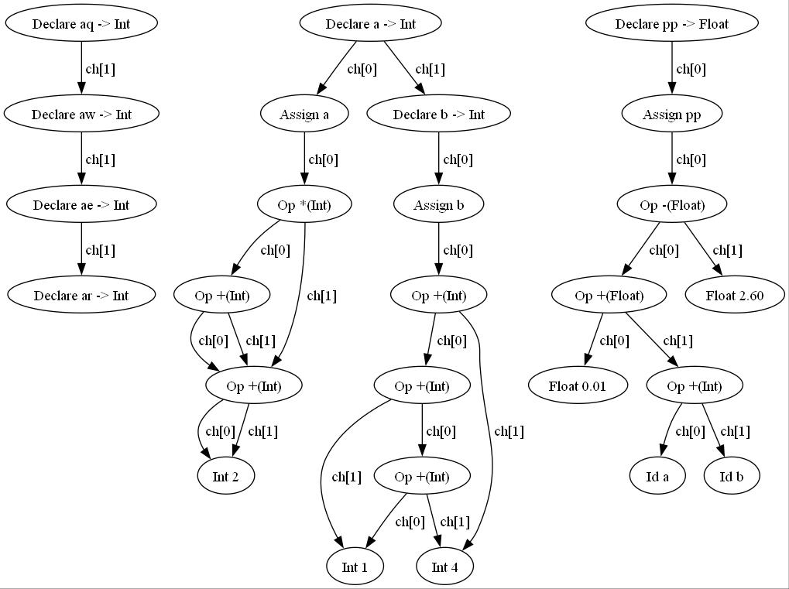
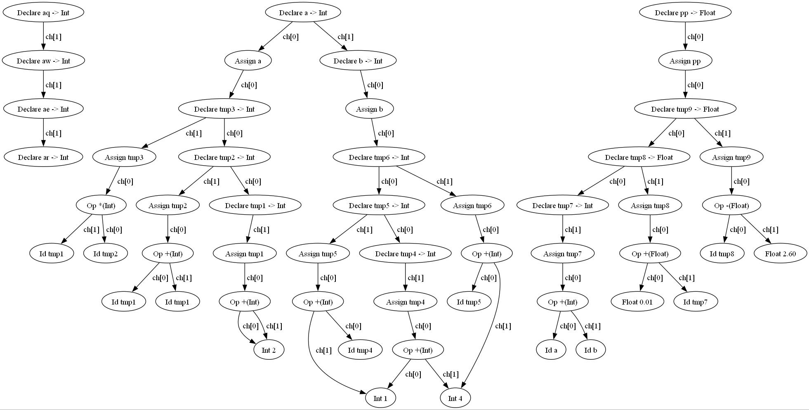
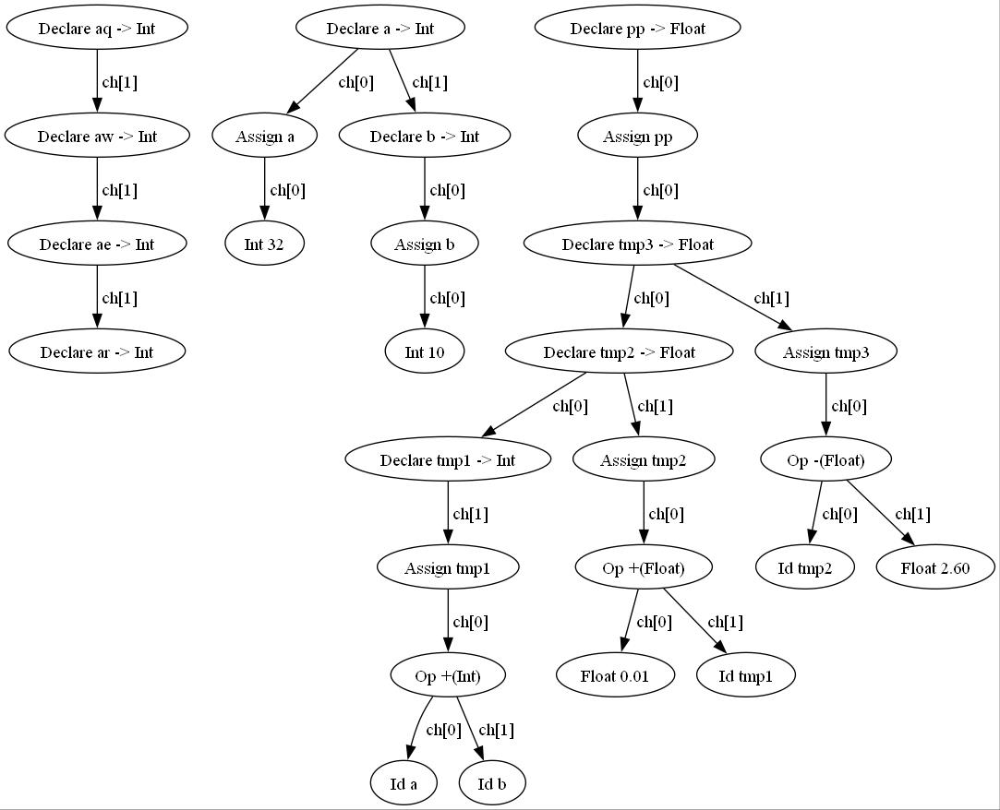

# TINY 编译器扩展

[English](README.md)

本项目在 TINY 编译器的基础上扩展了语言特性与表达式优化，并提供 TM 虚拟机运行生成的指令。

## 亮点

### 1. 浮点数运算

支持浮点数常量和算术运算。

### 2. 异或运算

支持整数异或运算符 `^`。

### 3. 大于等于和小于等于

在分析和 TM 指令生成中支持 `>=` 和 `<=`。

### 4. 整数条件

支持在 `if` 条件中直接使用整数。

### 5. 类型声明

支持 `int` 和 `float` 声明，变量声明后使用。

### 6. 声明初始化与重复声明检查

支持声明时赋初值，并检查重复声明。

### 7. 表达式 DAG 优化

在同一个表达式中合并重复的子表达式。



### 8. 临时变量优化

使用临时变量保存合并后的表达式结果，供生成的代码复用。



### 9. 声明类型检查

对声明中的常量初始化值进行类型检查。

### 10. 常量合并

合并表达式中的常量计算。



## 目录

```text
src/compiler/       编译器源文件
src/vm/             TM 虚拟机源文件
include/compiler/   编译器头文件
examples/           TINY 示例输入
docs/images/        语法树图片与 DOT 文件
docs/reference/     参考代码
```

## 示例

| 输入文件 | 展示内容 | 预期输出 |
| --- | --- | --- |
| `examples/arithmetic.tny` | 浮点数声明、初始化和乘法 | `10.000000` |
| `examples/conditions.tny` | `>=` 条件判断与整数异或 | `1`、`6` |
| `examples/optimization.tny` | 重复子表达式与临时变量 | `49` |

## 构建与运行

### Windows（PowerShell + MinGW）

准备 CMake 3.21 或更新版本、`g++` 和 `mingw32-make`，并将它们加入 `PATH`。在仓库根目录执行：

```powershell
cmake --preset mingw
cmake --build --preset mingw
Copy-Item examples/optimization.tny build/optimization.tny
cd build
.\tiny.exe optimization.tny
Get-Content .\optimization.tm
.\tm.exe optimization.tm
```

在 TM 提示符下输入 `g` 执行，输出 `49`；输入 `q` 退出，输入 `h` 查看虚拟机命令。

安装 Graphviz 后，在 `build` 目录执行以下命令生成并打开语法树图片：

```powershell
dot -Tpng syntax_tree.dot -o optimization.png
Invoke-Item .\optimization.png
```

### Linux / Macos

准备 CMake 3.16 或更新版本、`g++`、Make 和 Graphviz。在仓库根目录执行：

```sh
cmake -S . -B build -G "Unix Makefiles"
cmake --build build
cp examples/optimization.tny build/optimization.tny
cd build
./tiny optimization.tny
cat optimization.tm
dot -Tpng syntax_tree.dot -o optimization.png
./tm optimization.tm
```

在 TM 提示符下输入 `g` 执行，输入 `q` 退出。
