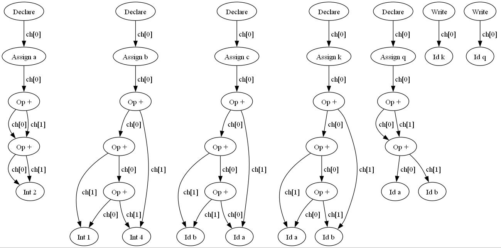
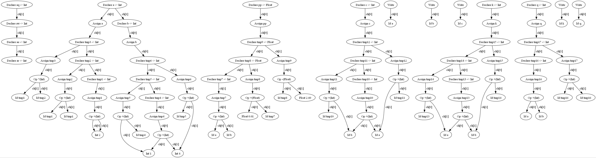
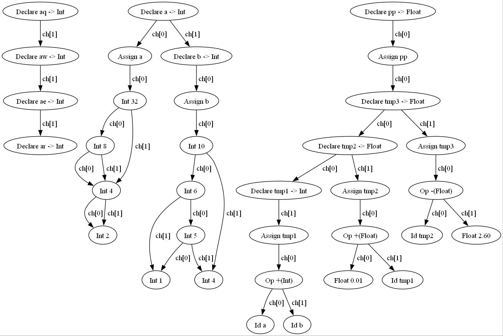

# 改进版 TINY 编译器

[English README](README.md)

在 Kenneth C. Louden《Compiler Construction: Principles and Practice》配套 TINY 编译器与 Tiny Machine 基础上的 C++ 教学扩展。编译器将 `.tny` 源程序转换为 `.tm` 指令，再由独立的交互式虚拟机执行。

## 功能与实现范围

- 整数、浮点数、科学计数法、异或 `^`、`>=` 与 `<=`。
- 变量声明、初始化、重复定义及未定义变量检查。
- 整数表达式条件、`if/else`、`repeat/until`、`read` 和 `write`。
- 表达式 DAG 合并、临时变量与常量折叠。
- 可选的 Graphviz 语法树可视化。

类型系统仍不完整：声明检查能发现部分常量类型不匹配，但变量类型没有在符号表和虚拟机存储中得到完整维护，不能将其当作完善的强类型语言实现。

## 环境与构建

需要 Git、CMake 3.16+、C++11 编译器；自动测试另需 Python 3.8+，只使用标准库。历史代码仍有字符串字面量转换等编译警告，尚未全部现代化。

Windows PowerShell + MinGW-w64（`g++`、`mingw32-make` 加入 PATH）：

```powershell
git clone https://github.com/L1ttle-Q/tiny_compiler_plus.git
cd tiny_compiler_plus
cmake -S . -B build -G "MinGW Makefiles" -DCMAKE_BUILD_TYPE=Release
cmake --build build --parallel
```

Linux/macOS 的配置命令省略 `-G "MinGW Makefiles"`。没有 Python、仅构建程序时，配置增加 `-DBUILD_TESTING=OFF`。Visual Studio 应使用独立构建目录，程序会位于如 `build-vs/Release/` 的配置子目录中。

原 `TC/Makefile` 仍可使用：Windows 在 `TC/` 中执行 `mingw32-make`，Unix 执行 `make`。也可在仓库根目录直接构建虚拟机：Windows 使用 `g++ -std=c++11 TM/tm.cpp -o TM/tm.exe`，Unix 使用 `-o TM/tm`。实际源文件是 **`tm.cpp`，不是 `tm.c`**。

## 编译并运行最小示例

仓库提供的 `examples/hello.tny`：

```text
int answer := 6 * 7;
write answer
```

从仓库根目录执行：

```powershell
cd examples
..\build\tiny.exe hello.tny
..\build\tm.exe hello.tm
```

Linux/macOS 将后两条改为 `../build/tiny hello.tny`、`../build/tm hello.tm`。建议切换到示例目录，用短文件名编译；当前输出路径处理使用遇到的第一个 `.`，含点的目录名可能导致输出路径错误。

进入 TM 的 `Enter command:` 提示后，输入 `g` 并回车。输出应包含 `OUT instruction prints: 42` 和 `HALT:`，再输入 `q` 退出。随后用 `cd ..` 回到仓库根目录，执行下方测试命令。

**启动虚拟机后还需输入 `g` 才会执行程序。** `.tm` 生成在源文件旁，`syntax_tree.dot` 写入当前工作目录，已有同名文件可能被覆盖。这里生成的是 VM 指令，不是系统原生可执行文件。

| TM 命令 | 作用 |
| --- | --- |
| `g` | 运行到停止或机器错误 |
| `s 1` | 单步执行一条指令 |
| `r` | 查看寄存器 |
| `i` / `d` | 查看指令 / 数据内存；可选范围见 `h` |
| `t` / `p` | 切换跟踪 / 指令计数输出 |
| `c` | 清空机器状态 |
| `h` / `q` | 帮助 / 退出 |

若源程序使用 `read`，在 VM 的 `IN` 指令提示时输入数值。

## 自动测试

在仓库根目录执行：

```powershell
ctest --test-dir build --output-on-failure
python tests/run_tests.py --compiler build/tiny.exe --machine build/tm.exe
```

Unix 程序路径去掉 `.exe`。Visual Studio 的 CTest 命令增加 `-C Release`，Python 脚本改用相应 `Release/` 路径。

8 项 CTest 覆盖整数异或、浮点算术、条件、未定义变量、缺失初始化表达式、原有 `triangle.tny`，以及另外两个历史示例的预期编译失败。测试在临时目录重新编译并执行新指令，检查数值输出、停止状态和超时；反例必须有非零退出码、失败诊断且不生成 `.tm`。

`TC/sample.tny` 目前在两个 `write` 之间缺分号；`TC/calc.tny` 使用了未声明变量。保留二者作为**预期失败用例**。`TC/triangle.tny` 中的输出语句位于注释内，因此成功运行只会停止，不打印 `OUT`。`TM/*.tm` 是历史产物，不能假定与当前 `.tny` 一致。

## 可选语法树图片

单独安装 Graphviz 并使 `dot` 可用后，在生成 DOT 文件的目录执行：

```sh
dot -Tjpg syntax_tree.dot -o syntax_tree.jpg
```

构建、编译、执行和测试不依赖 Graphviz。原有优化效果示意：





## 源码、限制与验证

- `TC/`：词法、语法、符号表、类型检查、优化与代码生成；`TM/tm.cpp`：指令载入和解释执行。
- `examples/hello.tny`：最小可运行示例；`tests/run_tests.py`：回归测试入口。
- VM 使用 1024 项指令内存、1024 项数据内存和 8 个寄存器，有固定输入缓冲区。大型或损坏输入尚无完整校验。
- 本次使编译失败返回非零，修复缺失赋值表达式时的空指针访问，并将 VM 的 `gets` 改为有长度限制、能处理 EOF 的输入；并未修复所有语法错误及算术边界情况。
- 2026-10-26：Windows、MinGW-w64 GCC 8.1、CMake 3.31、Python 3.14 下构建及全部 8 项 CTest 通过；Linux/macOS 和 Visual Studio 运行未在本轮验证。

使用 [Apache License 2.0](LICENSE)，源文件保留原 TINY/TM 作者说明。
